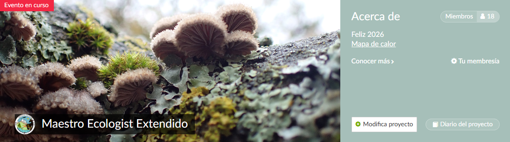
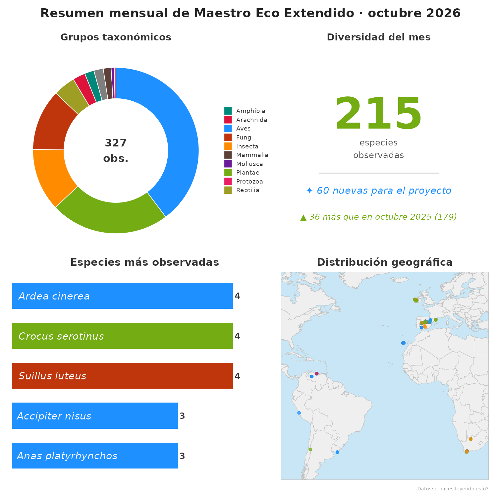

  

# Resumen mensual · Maestro Ecologist Extendido

Paneles mensuales generados automáticamente a partir de las observaciones
del proyecto [Maestro Ecologist Extendido](https://www.inaturalist.org/projects/maestro-ecologist-extendido)
en iNaturalist.

## Último panel

## Qué muestra cada panel

- **Grupos taxonómicos:** reparto de las observaciones del mes por grupo.
- **Diversidad del mes:** especies observadas, cuántas son nuevas para el
  proyecto y comparación con el mismo mes del año anterior.
- **Especies más observadas:** las 5 con más registros.
- **Distribución geográfica:** mapa con la ubicación de las observaciones.

Todos los paneles están en la carpeta [`figures`](figures/).

## Cómo funciona

Cada mes, GitHub Actions ejecuta `panel_inat_api.R`, que descarga las
observaciones nuevas desde la API de iNaturalist y genera los paneles.
Los datos se guardan en una caché (`data/`) para no descargar todo cada vez.

## Ejecutarlo a mano

1. Pestaña **Actions** → **Panel mensual iNaturalist**.
2. **Run workflow**.

## Créditos

Datos: observaciones de la comunidad en [iNaturalist](https://www.inaturalist.org).
